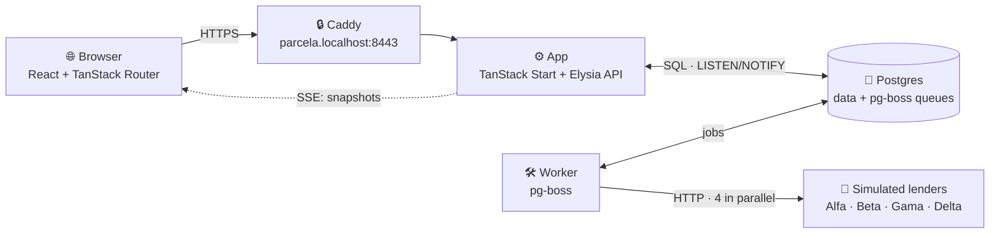
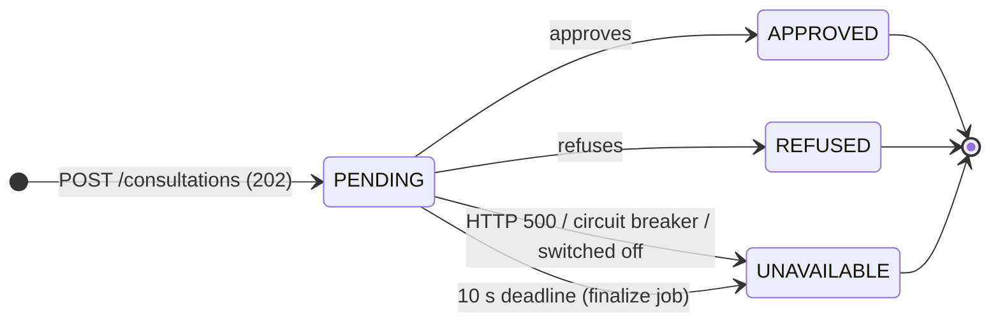
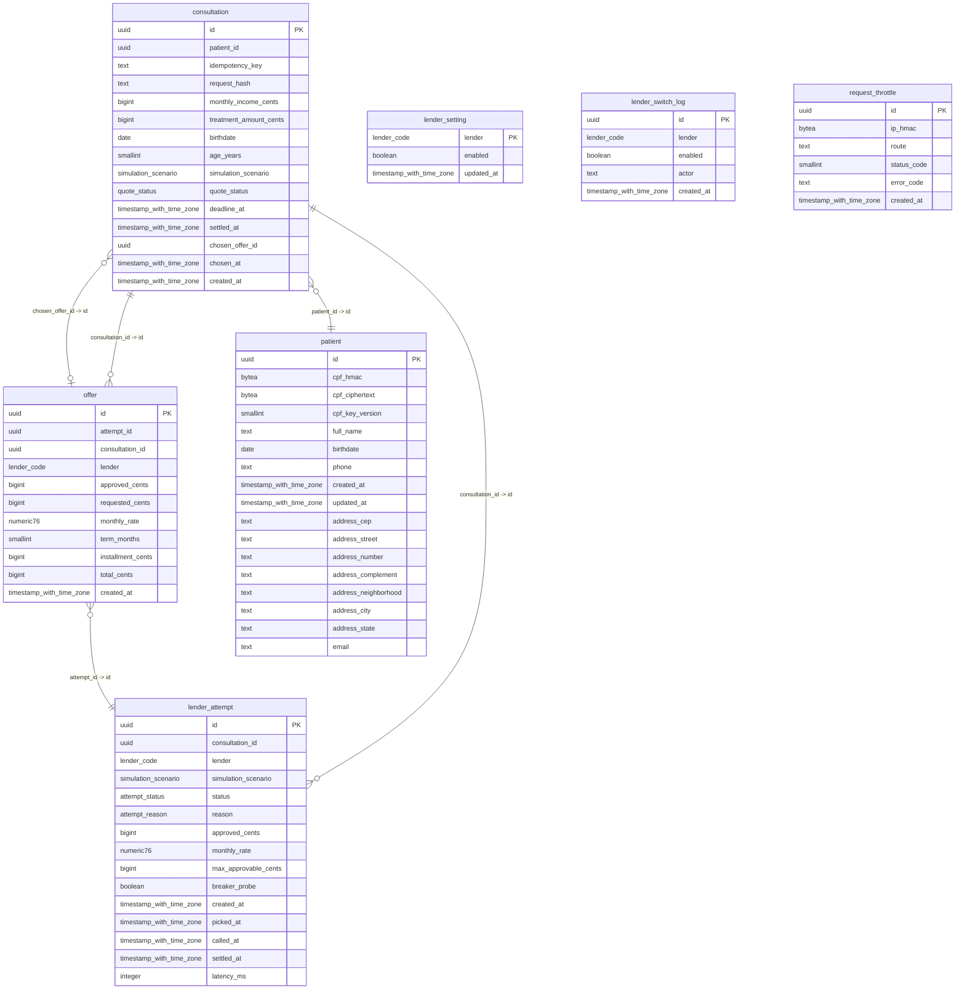
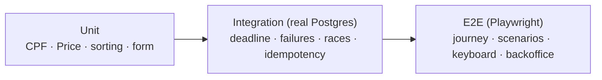
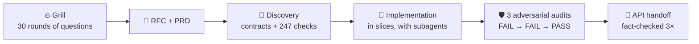
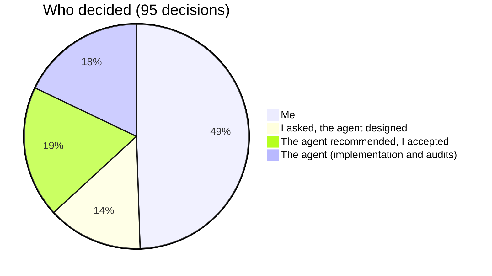

# Parcela Mais · Multi-lender pre-approval

> [🇧🇷 Português](README.md) · 🇺🇸 English

[](https://github.com/micaelcf/parcela-mais-case/actions/workflows/ci.yml)

The clinic fills in the patient's signup once; the backend queries **4 simulated lenders in parallel**, shows each answer **live** and, within **10 s**, moves on with whatever came back. The patient compares the offers (Price amortization) and picks one. _(The animations are labelled in Portuguese, like the app.)_


## Contents

[Run it](#run-it) · [Architecture](#architecture) · [Parallel quote](#parallel-quote-and-the-10-s-deadline) · [Live status](#live-status-why-sse) · [Database](#data-model) · [Decisions & trade-offs](#decisions-and-trade-offs) · [Tests](#tests) · [Left out & next steps](#left-out-and-next-steps) · [AI usage](#how-i-used-ai)

## Run it

You only need **Bun 1.4** and **Podman** (or Docker) with compose. One command:

```bash
bun run up
```

It installs the dependencies (free when they already are), creates `.env.local` as a copy of `.env.example` when there's none (an existing one is never rewritten), and starts Postgres + Caddy + migrations + app + worker.

Open **https://parcela.localhost:8443**. On the first run, `up` installs Caddy's local CA for your user (Windows/macOS ask once). `up` prints the backoffice URL and the dev credentials (`operador` / `parcela123`).

| Command                        | What it does                                                            |
| ------------------------------ | ----------------------------------------------------------------------- |
| `bun run up --prod`            | The same stack in production mode (built image, behind Caddy)           |
| `bun run doctor`               | Read-only diagnostics (dependencies, `.env.local`, ports, CA, database) |
| `bun run down`                 | Stops the containers **without deleting data**                          |
| `bun run prune`                | Full local reset (deletes the database volume)                          |
| `bunx vp test` / `bun run e2e` | Unit + integration tests / browser E2E                                  |

**Forced scenarios:** on the _Financeiro_ step, the **Cenário de simulação** field forces all approve, Delta fails, Delta times out, or none approve (on in dev via `SIMULATION_CONTROLS=true`).

## Architecture



- **One database, no Redis:** the queues (pg-boss) live in Postgres, and the jobs are created **in the same transaction** as the consultation.
- **One API:** the frontend only talks to the API (no SSR) through a typed client (Eden). The full contract is in the [API handoff](docs/features/pre-approval-journey/API_HANDOFF.md).
- **Lenders behind adapters:** the 4 simulations run as backend HTTP routes behind one interface; a real integration only swaps the adapter.

## Parallel quote and the 10 s deadline




- The `POST` answers **right away** (`202 {id}`); each lender is its own job, so a slow one never holds the others back.
- The deadline is a **job scheduled** at `creation + 10 s` (survives restarts), and reads also finalize a consultation past its deadline.
- **No retries** inside the 10 s; a per-lender **circuit breaker** and a backoffice **on/off switch** protect the journey.
- An offer can be **chosen as soon as it arrives**; lenders that answer after the choice (still within the deadline) are recorded without changing it. At the deadline, a call still unanswered is cut off and the lender shows as unavailable.
- **Nobody approved?** The screen explains each outcome without exposing internal rules and suggests **trying a lower amount** (a new consultation for the same patient).

## Live status: why SSE


| Option     | Why / why not                                                                                     |
| ---------- | ------------------------------------------------------------------------------------------------- |
| **SSE** ✅ | The flow is server → browser only; plain HTTP, native reconnect, goes through the proxy unchanged |
| Polling    | Simple, but laggy or wasteful; takes over as the **fallback** when SSE doesn't get through        |
| WebSocket  | Two-way for no reason; more infrastructure for the same result                                    |

Every connection starts with the **full snapshot**; Postgres `NOTIFY` only says "re-read"; a re-read every **2 s** covers a lost notification; a dropped connection reconnects with **backoff** (0.5 → 1 → 2 → 4 s). Reloading the page rebuilds everything from the consultation URL.

**Polling fallback:** when two connections in a row fail, when a connection goes 3 s without its first snapshot (a proxy holding the stream back), or when the consultation is 2 s past its deadline and still open, the page reads `GET /consultations/:id` every 2 s and says "Conexão ao vivo instável". Once SSE delivers again, polling stops; a read already on its way is dropped, so the page never goes back to an older state.

## Error pages

Loading errors land in TanStack Router's error boundary (`defaultErrorComponent` and `defaultNotFoundComponent`). The page shows the **real HTTP status** (404, 429, 503…), says what happened in Portuguese, and offers **Tentar de novo** when retrying makes sense: the button calls `router.invalidate()`, which re-runs the loaders (a bare `reset()` would only re-render the error). In the backoffice, the error stays inside its own layout. And the status digits are interactive: they spin up on load, lean toward the pointer, and can be clicked until they read 200.

## Data model



Money is stored in **integer cents**; the installment uses the **Price formula** with _half-up_ rounding in the pricing service. The **CPF** is encrypted (AES-256-GCM) with an HMAC index for lookups; public responses carry no CPF and no other personal data.

## Decisions and trade-offs

| Decision                                      | Gain                                                       | Cost                                                        |
| --------------------------------------------- | ---------------------------------------------------------- | ----------------------------------------------------------- |
| Queues in Postgres (pg-boss), separate worker | One less piece of infra; jobs atomic with the consultation | More load on the database; two processes                    |
| Deadline as a scheduled job                   | Survives restarts and a slow worker                        | One more moving part (races covered by tests)               |
| No retries on lender calls                    | A predictable 10 s budget                                  | A one-off failure shows as "unavailable"                    |
| `Idempotency-Key` per submission              | Double clicks and network retries don't duplicate          | Two tabs = two consultations (capped at 5/24 h per patient) |
| No SSR; frontend through the API only         | One contract, ready for a native app                       | First paint waits for JS                                    |
| _Offset_ pagination in the backoffice         | Simple, fine at this volume                                | Worse than _keyset_ on huge tables                          |
| Signup draft in `sessionStorage` (30 min)     | A reload loses nothing                                     | On a shared computer it stays readable up to 30 min         |
| TypeBox everywhere (API, form, env)           | One source of truth for validation and types               | Less common than zod                                        |

The full record (35 decisions with alternatives) is in the [RFC](docs/features/pre-approval-journey/RFC-pre-approval-journey.md); the requirements in the [PRD](docs/features/pre-approval-journey/PRD-pre-approval-journey.md).

## Tests



- **274** unit and integration tests (Vitest, real Postgres, no factories) + **81** browser E2E tests.
- They cover what can break: CPF check digits, Price cents, a lender that never answers, HTTP 500, the finalizer racing a late worker, two simultaneous choices, blocked SSE falling back to polling, the CPF kept out of public responses and URLs.
- **CI on GitHub Actions:** every pull request to `main` runs formatting, lint, types and the build; unit + integration tests on a real Postgres; the whole E2E suite against the stack `bun run up` itself starts; and the proxy specs against `bun run up --prod`. `main` only takes pull requests, with all four checks green.
- **Case bonuses:** resume after reload ✅ · keyboard and screen-reader accessibility ✅ · per-lender logs and metrics (backoffice) ✅ · public deploy ⏭️

## Left out and next steps

- **Public deploy:** a VPS with real HTTPS; `vp run deploy` already exists and runs on the server itself, it needs a domain and a machine.
- **Tune Delta's circuit breaker:** it trips in ~7% of normal windows; raise the threshold or stop counting timeouts.
- **Observability:** logs are already JSON (tslog); export per-lender metrics and traces (OpenTelemetry).
- **Real authentication (Better Auth):** the backoffice has a single operator from env, and the cookie stays valid until it expires.
- **Real lender integrations and webhooks:** swap the simulated adapters for real APIs and receive asynchronous answers by webhook.

Out of scope by decision: post-choice stages (contract, payment) and lender retries.

## The hardest part

The part that took longest was validating and refining after the first delivery. The usual story: everything running, tests 100% green with no errors, specs checked and followed. I open the result in the browser: a so-so UI (I need judgement and taste for that, lol), a just-okay multi-step form, and a point or two of UI and UX here and there. I think about the edge cases and what could go wrong, tell the AI to check, fix and test it; I think about which improvements are worth making now and tell it that too. Basically, that loop of testing, judging and giving feedback is what takes longest; the rest was quick. The coding agent really did deliver everything working, apparently with no functional bugs or things that break; what I did was just refine and try to improve it (whether it's actually good or not is for you to say).

## How I used AI

I built this together with an AI agent ([oh-my-pi](https://github.com/can1357/oh-my-pi), Claude model) in a single ~30 h session. I decided the stack, scope and rules; the agent proposed alternatives, wrote the code and tests, and audited its own work.

None of it was random or driven by loose prompts: I used an open-source harness I built myself, which runs the decisions, the Q&A, writing the spec, the parallel implementation, and how the AI tests and checks its own work: [ef-harness](https://github.com/micaelcf/ef-harness) (a star is welcome ⭐).





- **I decided:** the stack (TanStack Start, Elysia, Bun, Vite+, TypeBox, pg-boss instead of Redis), Podman/Docker with one command, ops commands with no remote connections, no SSR, business rules centralized in the domain, circuit breaker + on/off switch, tests on real Postgres, _offset_ pagination and the signup UX (blur validation, review step, buttons, theme); plus the bugs I found testing by hand.
- **I asked, the agent designed:** the `sessionStorage` draft, local HTTPS with automatic trust, `vp run down`, backoffice access.
- **The agent recommended, I accepted:** SSE with snapshots, one job per lender + finalizer, no retries, encrypting only the CPF, a capability URL without personal data.
- **The agent decided alone:** integer cents with _half-up_ rounding, `Idempotency-Key`, LISTEN before the snapshot + 2 s re-read, and the audit fixes (data leaks, the dev server exposed on the network).
- **Every decision, with its owner and evidence:** [docs/DECISOES.md](docs/DECISOES.md) (in Portuguese; quoted evidence kept as written).

## Documentation

[RFC](docs/features/pre-approval-journey/RFC-pre-approval-journey.md) · [PRD](docs/features/pre-approval-journey/PRD-pre-approval-journey.md) · [API handoff](docs/features/pre-approval-journey/API_HANDOFF.md) · [Grill](docs/features/pre-approval-journey/grill-decisions-2026-10-27-pre-approval-journey.md) · [Decisions](docs/DECISOES.md) · [CPF protection (visual)](docs/features/pre-approval-journey/cpf-protection-explainer.html)
