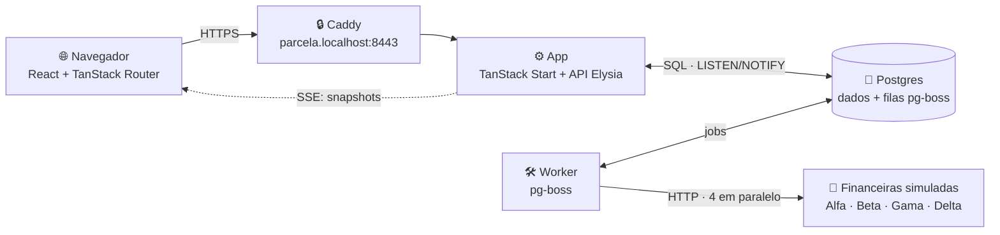
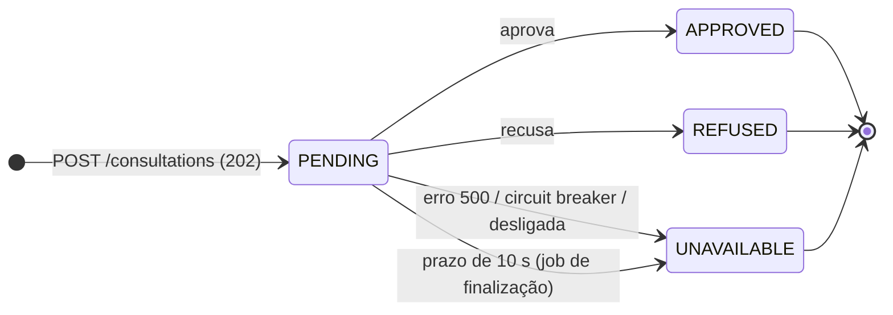
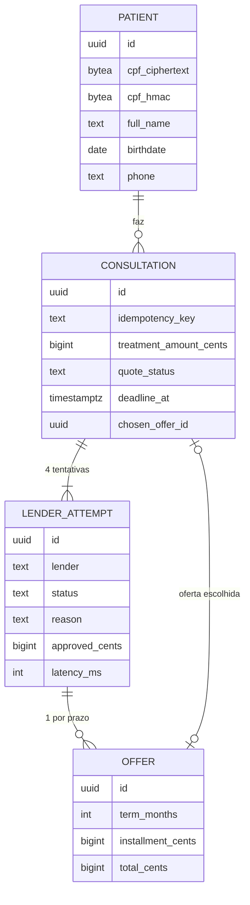
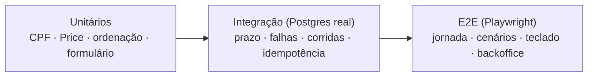
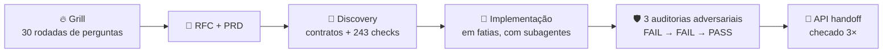
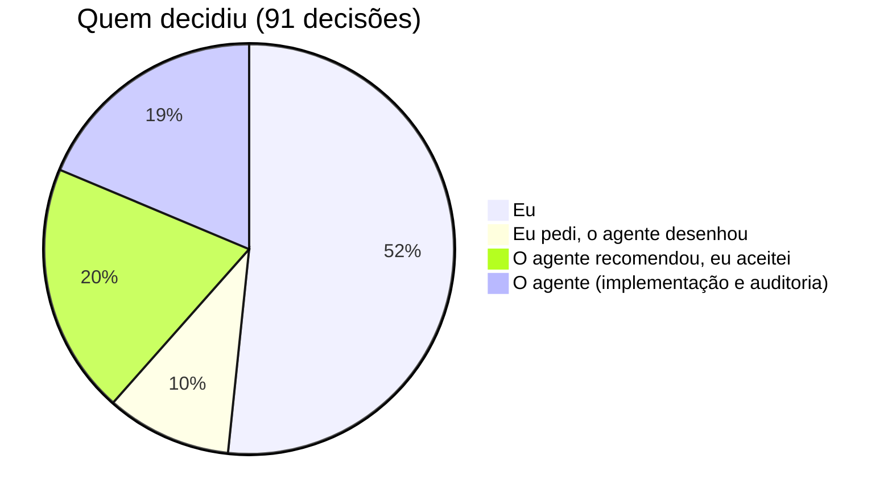

# Parcela Mais · Pré-aprovação em várias financeiras

> 🇧🇷 Português · [🇺🇸 English](README.en.md)

A clínica preenche o cadastro do paciente uma vez; o backend consulta **4 financeiras simuladas em paralelo**, mostra cada resposta **ao vivo** e, em até **10 s**, segue com o que voltou. O paciente compara as ofertas (Tabela Price) e escolhe uma.


## Sumário

[Como rodar](#como-rodar) · [Arquitetura](#arquitetura) · [Consulta em paralelo](#consulta-em-paralelo-e-prazo-de-10-s) · [Status ao vivo](#status-ao-vivo-por-que-sse) · [Banco](#modelo-de-dados) · [Decisões e trade-offs](#decisões-e-trade-offs) · [Testes](#testes) · [Fora do escopo e próximos passos](#o-que-ficou-de-fora-e-próximos-passos) · [Uso de IA](#como-usei-ia)

## Como rodar

Precisa de **Bun 1.4** e **Podman** (ou Docker) com compose.

```bash
bun install
cp .env.example .env.local
bunx vp run up        # Postgres + Caddy + migrações + app + worker
```

Abra **https://parcela.localhost:8443**. Na primeira vez, o `up` instala a CA local do Caddy no seu usuário (o Windows/macOS pede uma confirmação). O `up` imprime a URL do backoffice e as credenciais de dev (`operador` / `parcela123`).

| Comando                            | O que faz                                                      |
| ---------------------------------- | -------------------------------------------------------------- |
| `bunx vp run up --prod`            | Mesma stack em modo produção (imagem buildada, atrás do Caddy) |
| `bunx vp run doctor`               | Diagnóstico sem alterar nada (portas, CA, banco, migrações)    |
| `bunx vp run down`                 | Para os containers **sem apagar dados**                        |
| `bunx vp run prune`                | Reset local completo (apaga o volume do banco)                 |
| `bunx vp test` / `bunx vp run e2e` | Testes unitários + integração / E2E no navegador               |

**Cenários forçados:** no passo _Financeiro_, o campo **Cenário de simulação** força `Todas aprovam`, `Delta falha`, `Delta estoura o tempo` ou `Nenhuma aprova` (ligado em dev por `SIMULATION_CONTROLS=true`).

## Arquitetura



- **Um banco, sem Redis:** as filas (pg-boss) vivem no próprio Postgres, e os jobs são criados **na mesma transação** da consulta.
- **API única:** o front consome só a API (sem SSR), com cliente tipado (Eden). O contrato completo está no [API_HANDOFF](docs/features/pre-approval-journey/API_HANDOFF.md).
- **Financeiras atrás de adapters:** as 4 simulações rodam como rotas HTTP do backend, com uma interface comum; trocar por uma integração real muda só o adapter.

## Consulta em paralelo e prazo de 10 s




- O `POST` responde **na hora** (`202 {id}`); cada financeira é um job próprio, então uma lenta não segura as outras.
- O prazo é um **job agendado** para `criação + 10 s` (sobrevive a restart) e a leitura também finaliza se o prazo já passou.
- **Sem retry** dentro dos 10 s; um **circuit breaker** por financeira e um **liga/desliga** no backoffice protegem a jornada.
- Dá para escolher uma oferta **assim que ela chega**; respostas tardias são registradas sem mudar a escolha.
- **Ninguém aprovou?** A tela explica cada motivo sem expor regras internas e sugere **simular com um valor menor** (nova consulta, mesmo paciente).

## Status ao vivo: por que SSE


| Opção      | Por que sim / não                                                                                  |
| ---------- | -------------------------------------------------------------------------------------------------- |
| **SSE** ✅ | O fluxo é só servidor → navegador; HTTP comum, reconexão nativa, passa pelo proxy sem configuração |
| Polling    | Simples, mas atrasa ou desperdiça requisições; fica como fallback (`GET /consultations/:id`)       |
| WebSocket  | Bidirecional sem necessidade; mais infraestrutura para o mesmo resultado                           |

Cada conexão começa com o **snapshot completo**; o `NOTIFY` do Postgres só avisa "releia"; uma releitura a cada **2 s** cobre um aviso perdido; a queda de conexão reconecta com **backoff** (0,5 → 1 → 2 → 4 s). Recarregar a página reconstrói tudo a partir da URL da consulta.

## Modelo de dados



Dinheiro em **centavos inteiros**; a parcela usa a **Tabela Price** com arredondamento _half-up_ no serviço de preço. O **CPF** fica cifrado (AES-256-GCM) com um índice HMAC para busca; respostas públicas não carregam CPF nem outros dados pessoais. O backoffice também usa `lender_setting`, `lender_switch_log` e `request_throttle`.

## Decisões e trade-offs

| Decisão                                           | Ganho                                           | Custo                                                       |
| ------------------------------------------------- | ----------------------------------------------- | ----------------------------------------------------------- |
| Filas no Postgres (pg-boss), worker separado      | Uma infra a menos; jobs atômicos com a consulta | Mais carga no banco; dois processos                         |
| Prazo como job agendado                           | Sobrevive a restart e a worker lento            | Mais uma peça para testar (corridas cobertas)               |
| Sem retry nas financeiras                         | Prazo previsível de 10 s                        | Uma falha pontual vira "indisponível"                       |
| `Idempotency-Key` por envio                       | Duplo clique / retry de rede não duplica        | Duas abas = duas consultas (limitado a 5/24 h por paciente) |
| Sem SSR; front só via API                         | Um contrato só, pronto para app nativo          | Primeira pintura depende do JS                              |
| Paginação _offset_ no backoffice                  | Simples e suficiente no volume do case          | Pior que _keyset_ em tabelas enormes                        |
| Rascunho do cadastro em `sessionStorage` (30 min) | Recarregar não perde nada                       | Num computador compartilhado, fica legível até 30 min       |
| TypeBox em tudo (API, formulário, env)            | Uma fonte de verdade para validação e tipos     | Menos comum que zod                                         |

O registro completo (35 decisões com alternativas) está na [RFC](docs/features/pre-approval-journey/RFC-pre-approval-journey.md); os requisitos, no [PRD](docs/features/pre-approval-journey/PRD-pre-approval-journey.md).

## Testes



- **258 testes** unitários e de integração (Vitest, Postgres real, sem _factories_) + **77** E2E no navegador.
- Cobrem o que pode quebrar: dígitos do CPF, centavos da Price, financeira que não responde, erro 500, finalizador correndo contra worker atrasado, dupla escolha simultânea, CPF fora das respostas públicas e da URL.
- **Bônus do case:** retomar após recarregar ✅ · acessibilidade de teclado e leitor de tela ✅ · logs e métricas por financeira (backoffice) ✅ · deploy público ⏭️

## O que ficou de fora e próximos passos

- **Deploy público:** VPS com HTTPS real; o `vp run deploy` já existe e roda no próprio servidor, faltam domínio e máquina.
- **Ajustar o circuit breaker da Delta:** hoje ele dispara em ~7% das janelas normais; subir o limiar ou não contar _timeouts_.
- **Observabilidade:** os logs já saem em JSON (tslog); falta exportar métricas e traços por financeira (OpenTelemetry).
- **Autenticação de verdade (Better Auth):** o backoffice tem um operador só, por variável de ambiente, e o cookie vale até expirar.
- **Integrações reais com financeiras e webhooks:** trocar os adapters simulados por APIs reais e receber respostas assíncronas por webhook.

Fora do escopo por decisão: etapas pós-escolha (contrato, pagamento) e retentativas nas financeiras.

## Como usei IA

Construí o projeto em par com um agente de IA ([oh-my-pi](https://github.com/can1357/oh-my-pi), modelo Claude), numa única sessão de ~30 h. Eu decidi stack, escopo e regras; o agente propôs alternativas, escreveu o código e os testes, e auditou o próprio trabalho.





- **Eu decidi:** stack (TanStack Start, Elysia, Bun, Vite+, TypeBox, pg-boss no lugar de Redis), Podman/Docker com um comando, comandos de ops sem conexão remota, sem SSR, regras centralizadas no domínio, circuit breaker + liga/desliga, testes em Postgres real, paginação _offset_ e a UX do cadastro (validação no _blur_, revisão, botões, tema); e os bugs que achei testando à mão.
- **Eu pedi, o agente desenhou:** rascunho em `sessionStorage`, HTTPS local com confiança automática, `vp run down`, acesso ao backoffice.
- **O agente recomendou, eu aceitei:** SSE com snapshot, um job por financeira + finalizador, sem retry, criptografia só do CPF, URL de capacidade sem PII.
- **O agente decidiu sozinho:** centavos inteiros com _half-up_, `Idempotency-Key`, LISTEN antes do snapshot + releitura de 2 s, e as correções das auditorias (vazamentos de dados, dev server exposto na rede).
- **Cada decisão, com dono e evidência:** [docs/DECISOES.md](docs/DECISOES.md).

## Documentação

[RFC](docs/features/pre-approval-journey/RFC-pre-approval-journey.md) · [PRD](docs/features/pre-approval-journey/PRD-pre-approval-journey.md) · [API handoff](docs/features/pre-approval-journey/API_HANDOFF.md) · [Grill](docs/features/pre-approval-journey/grill-decisions-2026-10-27-pre-approval-journey.md) · [Decisões](docs/DECISOES.md) · [Proteção do CPF (visual)](docs/features/pre-approval-journey/cpf-protection-explainer.html)
